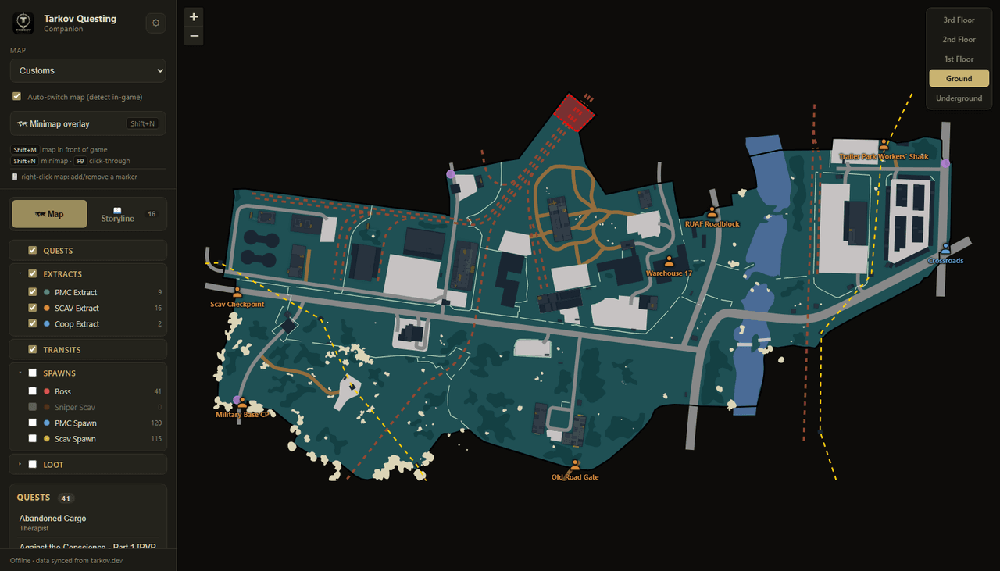
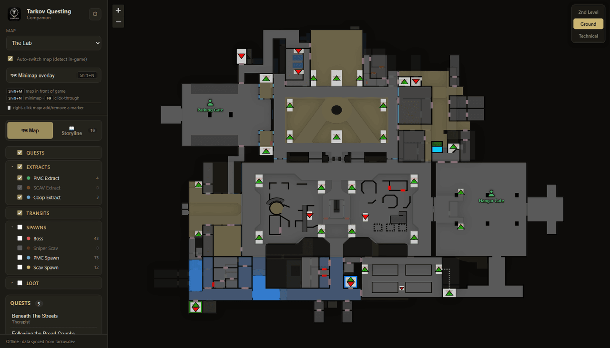
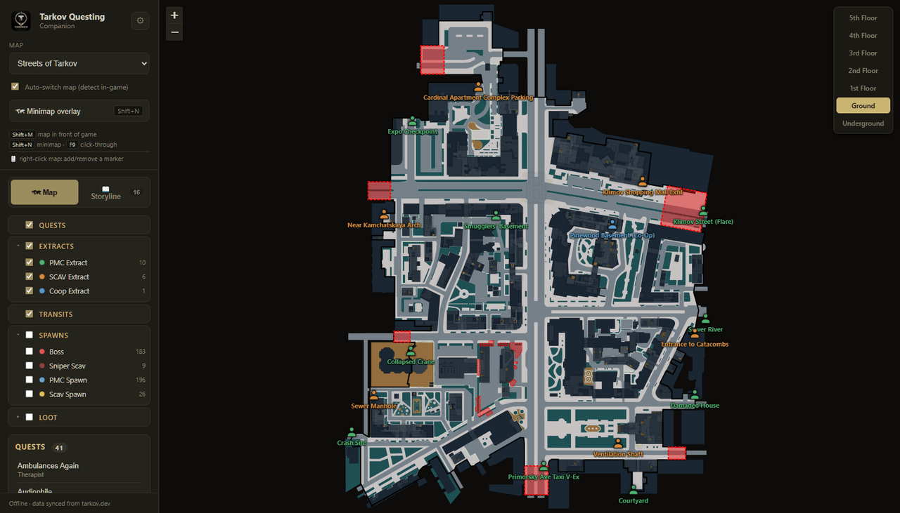
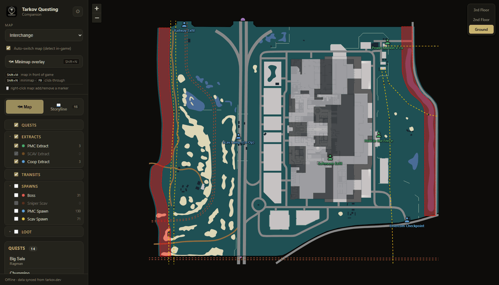

<div align="center">

# 🗺️ Tarkov Questing Companion

**A lightweight desktop companion for Escape from Tarkov that follows your position live on interactive maps and shows exactly where your quest objectives are.**

[](https://tauri.app/)
[](https://react.dev/)
[](https://www.typescriptlang.org/)
[](https://leafletjs.com/)
[](#)
[](LICENSE)

</div>

---

## Overview

Tarkov Questing Companion is a native desktop app that runs alongside the game and turns map-reading into something effortless. It **detects which map you load into**, **tracks where you are in the raid**, and overlays **quest markers, objectives, loot, exits and your own pins** on top of high-resolution maps — so you always know where to go next.

No memory reading, no injection, no overlays on top of the game. It works purely by watching the screenshots and log files the game already writes to disk.

## 📸 Screenshots

<div align="center">



<table>
  <tr>
    <td></td>
    <td></td>
  </tr>
  <tr>
    <td></td>
    <td align="center"><em>🎮 Live in-raid<br/>player tracking<br/>(coming soon)</em></td>
  </tr>
</table>

</div>

## ✨ Features

- 🧭 **Live player tracking** — your position and facing direction update on the map as you play, with an always-on-top minimap window.
- 🎯 **Quest objectives on the map** — every task from [tarkov.dev](https://tarkov.dev) plotted by location, with an "Objective i/N" badge and reference images per point.
- 🗂️ **Auto map detection** — the app reads the game logs and switches to the correct map when you load into a raid.
- 🪜 **Floor switching** — multi-level maps (Labs, Interchange, Streets…) filter loot, spawns, exits and transits by floor automatically as you move.
- 💎 **Loot & exits** — extracts, transits, spawns and loot points rendered with clean per-type SVG glyphs.
- 📌 **Custom markers** — drop your own colored pins anywhere to mark stashes, fights or routes.
- 🧩 **Quest guides & images** — synced objective descriptions and screenshots to help you find tricky spots.
- 🌍 **Bilingual** — English and Portuguese (BR).

## 🔧 How it works

Escape from Tarkov writes your coordinates into the **filename of every in-raid screenshot**, and logs the map name when a raid loads. The companion simply watches those files:

| Source | What it gives | Used for |
| --- | --- | --- |
| Screenshot folder | `x, y, z` position + facing | Live player arrow & floor tracking |
| Game log files | Loaded location | Automatic map switching |
| [tarkov.dev](https://tarkov.dev) API | Quests, objectives, markers | Map data (synced offline) |

Just bind a screenshot key in-game and press it whenever you want your position refreshed.

## 🗺️ Supported maps

Customs · Factory · Ground Zero · Interchange · Lighthouse · Reserve · Shoreline · Streets of Tarkov · Woods · Terminal · The Lab · The Labyrinth

---

## 🚀 Getting started

### Prerequisites

- [Node.js](https://nodejs.org/) 18+
- [Rust](https://www.rust-lang.org/tools/install) (stable) + the [Tauri prerequisites](https://tauri.app/start/prerequisites/) (on Windows: WebView2, usually already installed)

### Run in development

```bash
npm install
npm run tauri dev
```

### Build a release binary

```bash
npm run tauri build
```

The installer/executable is produced under `src-tauri/target/release/`.

### Refresh map data (optional)

Quest data is bundled, but you can re-sync it from tarkov.dev at any time:

```bash
npm run sync           # quests, markers & metadata
npm run sync:images    # objective reference images
```

### First use

1. Launch the app and open **Settings** to confirm your Tarkov **screenshots folder** (defaults to `Documents\Escape from Tarkov\Screenshots`).
2. Make sure you have a **screenshot key** bound in the game.
3. Drop into a raid — the map switches automatically. Press your screenshot key to update your position.

---

## 🙏 Credits

- Quest data and markers from the wonderful [tarkov.dev](https://tarkov.dev) project and its contributors.
- Built with [Tauri](https://tauri.app/), [React](https://react.dev/) and [Leaflet](https://leafletjs.com/).

## ⚠️ Disclaimer

This is an **unofficial, fan-made** tool and is **not affiliated with, endorsed by, or associated with Battlestate Games**. *Escape from Tarkov* and all related assets are property of Battlestate Games. The app does not interact with the game process in any way — it only reads files the game writes to disk.

## 📄 License

Released under the [MIT License](LICENSE).
